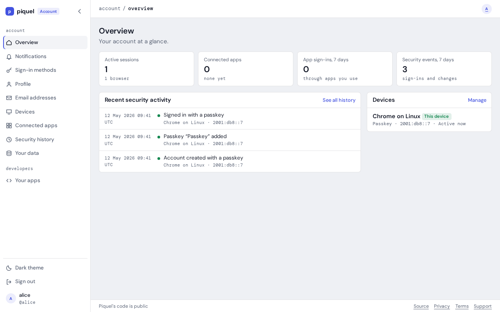

# Changing the documentation

The documentation is an [mdBook](https://rust-lang.github.io/mdBook/) book
built from the Markdown files under `docs/`. `book.toml`, at the repository
root, configures it.

## Where pages go

- `docs/user/` is the user guide, for people with a piquel.fr account and for
  people building apps that sign in with it. Its pages say what piquel.fr does
  and how to use it, not how it is implemented.
- `docs/dev/` is the contributor guide, for people who change piquel.fr:
  development setup, testing, architecture, security, how to extend it, and how
  it is operated. Operating piquel.fr belongs here, since only its maintainers
  run it.
- `docs/SUMMARY.md` is the table of contents. A page it doesn't list is not
  published, and a page it lists that doesn't exist fails the build.
- A page about one directory of the repository, such as how to run the browser
  tests, may stay a `README.md` in that directory, where GitHub shows it.
  `packages/auth/README.md` also introduces the TypeScript SDK wherever the
  package is read on its own.

Some pages are generated from the code, so they can't fall behind it. Change
their source, then run `just docs reference`; `just test` fails while they are
stale:

- `docs/dev/operations/cli-commands.md` comes from the `auth-service` command
  line's clap definitions in `apps/auth-service/src/cli`: their doc comments are
  also what `--help` prints.
- `docs/dev/operations/variables/` comes from the doc comments of the variables
  that `piquel_common::variables!` declares, in `apps/auth-service/src/config`
  and `apps/web/src/main.rs`. The configuration page includes them with
  `{{#include}}`. Write those doc comments for operators: what the variable
  does, its format, and whether it is required. The default is added from the
  code.

`.gitattributes` marks every generated file, so GitHub collapses it in pull
request diffs: list a new one there too.

Don't document what explains itself elsewhere. A migration says what it does,
and why, in its own SQL comments. A test says what it checks in its name and
doc comment. Commit history records how things changed.

## Writing

- Update the documentation in the same pull request as the change it
  describes.
- Describe a feature through each of its surfaces: the settings or developer
  console, the admin dashboard, the `auth-service` CLI and the SDKs. When a
  task can be done on more than one, show each way, and never present one as
  the only way. If a surface can't do it, say so.
- Keep a page to one task or topic, and link to the reference rather than
  repeating it.
- Describe how piquel.fr works now, not how it changed.
- Write placeholders in prose as `` `<name>` `` or `\<name>`. A bare `<name>`
  is an HTML tag: it hides the text, and `just docs` fails.

## Style

Write so that someone new to piquel.fr can follow the page from top to bottom.

- **Start with the reader's goal.** Open each page with one or two sentences
  saying what it helps them do.
- **Keep sentences short, one idea per paragraph.** A sentence that needs a
  parenthesis and a semicolon is two sentences.
- **Show, then explain.** Put the command or code first, then say what it does
  and what the reader should see.
- **Number the steps of a procedure.** Give each step one action.
- **Warn before a command that deletes data** or can't be undone, not after
  it.
- **Cover the main path first.** Limits, edge cases and failure modes go at
  the end of the page, under *Troubleshooting* or *Limits*, or in the
  reference.
- **Leave internals out of the user guide.** Explain what the reader can see
  and do; how auth does it belongs in the contributor guide.
- Address the reader as "you", use the present tense, and write the labels of
  buttons and fields in **bold**, exactly as they appear.
- Link a concept where it is first mentioned instead of explaining it again.

For example, rather than:

> `client rotate-secret` issues a secret; earlier ones stay valid for
> `--grace` (default 24h, max 30d; `0` revokes).

write:

> Give the app a new secret:
>
> ```console
> auth-service client rotate-secret notes --grace 24h
> ```
>
> The command prints the new secret once. The app's earlier secrets keep
> working for 24 hours, so you can switch the app over without downtime.

The user guide's feature guides share one outline:

```markdown
# <Feature>

What it does and when to use it, in a sentence or two.

## Before you start

What the reader needs first: an account, a registered app, an SDK.

## <Task>

Numbered steps, through each surface that can do it. Give each task its own
section, named after what the reader does, such as "Rotate a secret".

## Check that it works

## Troubleshooting
```

## Screenshots

Show a page where it helps the reader find their way, such as the first time a
guide uses it, or a step done through a form. The text must still make sense
without the image. Images go in `docs/images/<section>/`.

Screenshots of auth's pages are generated, never taken by hand, so they always
match the pages. Retake them after changing a page they show:

```console
just docs screenshots
```

The recipe deploys this checkout to a fresh preview in the `docs` slot, runs the
specs in `tests/browser/screenshots/` against it, then deletes it. It needs what
`just preview` needs, and Playwright's Chromium
(`pnpm exec playwright install chromium`). Each spec signs up an account and
does what its guide does, then saves each page with `shoot` from
`tests/browser/screenshots/docs.ts`:

- `handle('alice')` gives a new handle, which every image shows as `alice`.
- `shoot(page, '<section>/<name>', area)` saves the window, 1280 by 800 pixels,
  in the dark theme, or only the element `area`, as `docs/images/<section>/<name>.png`. It first
  replaces what changes from run to run: handles, the preview's hosts, IDs,
  dates, addresses and trace IDs.

An image is rewritten only when its page looks different, so a run that changes
nothing leaves `docs/images` untouched. The browser suite never runs these
specs, and neither does CI.

Screenshots of other services, such as GitHub's or Google's consoles, are taken
by hand: keep them few, since those pages change without notice.

Give each image alt text that says what it shows, for readers who can't see it:

```markdown

```

## Links

- Link to another page with its path relative to the current page. From a
  page in `docs/user/apps/`, for example, the OpenID Connect reference is
  `[claims](../reference/oidc.md#authentication-claims)`. These links work
  both on GitHub and in the book.
- Link to a repository file outside `docs/` with its GitHub URL on `main`, such
  as `https://github.com/piquel-fr/piquel-fr/blob/main/infra/piqueld.toml`
  (`tree` instead of `blob` for a directory). A relative path would break in
  the book. The link check resolves these URLs against your checkout, so the
  file must exist on your branch, and fails links to any other branch or
  commit.
- Code comments name a page by its path from the repository root, such as
  `docs/dev/architecture/sdk.md`. Update them when you move a page.
- A heading's anchor is its text in lower case, with spaces replaced by hyphens
  and punctuation removed. Renaming a heading breaks the links to it; the link
  check finds them.

## Building and checking

`just install-tools` installs mdBook and lychee, at the versions CI uses.

```console
just docs serve   # serves the book on localhost:3000, rebuilding on every change
just docs         # builds the book into target/book and checks it
```

`just docs` fails on any mdBook warning, then checks with
[lychee](https://lychee.cli.rs/) every link and heading anchor in the built
book and in the repository's other Markdown files, such as `README.md`. It
works offline, so it doesn't check links to other websites; CI would otherwise
fail whenever one of them is down.

The `docs` CI job runs `just docs` on every pull request, because a change
anywhere in the repository can break a link to it.

Every deployment publishes the book of its own commit: production at
<https://docs.piquel.fr>, staging at `docs.staging.piquel.fr`, and `just preview`
at the `docs-<slug>.dev.piquel.fr` it prints. See
[documentation](operations/deploying.md#documentation).
