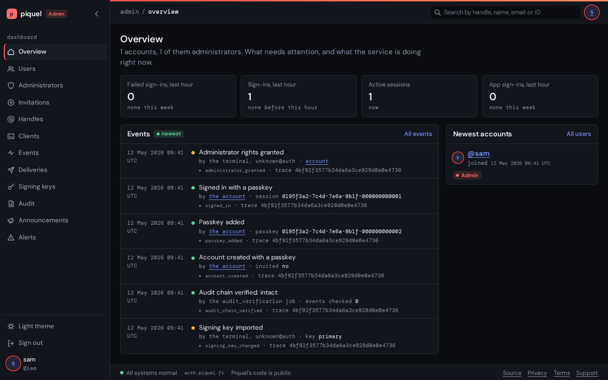

# Administration

This page helps you run sourceorigin.dev's accounts: grant administrators, invite
people, help an owner who lost their passkeys, act on an account that breaks the
rules, send announcements, respond to alerts, and repair auth's own state.

Two surfaces run the same code (`AdminService` in
`apps/auth-service/src/admin`, and `AccountService` in
`apps/auth-service/src/account` for an account's settings):

- **The admin dashboard**, for administrators, at `admin.sourceorigin.dev`, from the
  tailnet only.
- **The `auth-service` command line**, for operators. It has a command for every
  administrative operation, and needs only the database, so it works while auth
  is down. In an environment, run it with `piquelctl app exec` (see
  [running auth-service commands](deploying.md#running-auth-service-commands)),
  and locally with `just auth …`. [auth-service commands](cli-commands.md) lists
  every command with its options.



## Grant the first administrator

Only the command line grants the first administrator, once the environment is
deployed. In production (for staging, use `--env staging` and its own hosts):

1. Create an invitation, since signing up needs one:

   ```sh
   piquelctl app exec sourceorigin auth --env production -- auth-service invite create
   ```

2. Open the link it prints, and sign up with a passkey.
3. Grant the new account administrator rights:

   ```sh
   piquelctl app exec sourceorigin auth --env production -- auth-service admin grant <handle>
   ```

4. From a device on the tailnet, open `https://admin.sourceorigin.dev`, and sign in
   with the passkey.

Grant further administrators on the dashboard's **Administrators** page, with
**Grant rights**, or with `admin grant`. `admin list` lists them, oldest grant
first.

## Sign in to the admin dashboard

1. Open the dashboard. It sends the browser to auth's `/admin` page.
2. Sign in with a passkey, if the browser isn't already: a session signed in
   with GitHub or Google is asked for a passkey first.
3. Select **Confirm with a passkey**. Auth asks for your passkey every time you
   sign in to the dashboard, then sends the browser back, signed in.

Signing in counts as a confirmation for five minutes. A later change asks for a
passkey again, unless you gave one in the last five minutes. The dashboard signs
you out after 30 minutes without a request, and 12 hours after you signed in.
It also signs you out when you sign out of auth, or when your administrator
rights are revoked. Your security history lists each sign-in to the dashboard,
and your **Devices** page lists the dashboard under the browser it runs in. See
[how the dashboard signs administrators in](#how-the-dashboard-signs-administrators-in).

## Invite someone

Signing up needs an invitation in staging and production.

- **On the dashboard**, open **Invitations**, select **Invite someone**, choose
  how long it's **Valid for**, and select **Create link**.
- **At the terminal**, run `auth-service invite create --expires-in 7d`.

Either shows a single-use signup link once: send it to the person. It opens
`/register` with the invitation filled in, and a signup through GitHub or Google
asks for it on its own page. A link lasts seven days unless you choose another
time, in hours (`24h`) or days (`7d`).

Revoke an unused link with **Revoke** on the **Invitations** page, or
`auth-service invite revoke <id>`, with the ID `invite list` shows.

## Find an account

```sh
auth-service user search ali     # by ID, or part of a handle, name or email
auth-service user show alice     # the account's profile, emails, passkeys, sessions and consents
```

Commands name an account by its handle, its ID, or a verified email of an active
account. On the dashboard, search on **Users**, then open the account.

Reading an account is recorded as a view, once an hour per administrator or
operator, since it shows personal data. Only the audit shows views, not the
owner.

## Disable or enable an account

```sh
auth-service user disable alice --reason "Spam"
auth-service user enable alice
```

Disabling ends the account's sessions and refresh tokens, and it can't sign in
until you enable it. On the dashboard, open the account and select **Disable**
or **Enable**. Nobody can disable the last active administrator's account.

## Change an account's settings for its owner

When an owner asks for help, or an account breaks the rules, change its settings
with the owner's own operations, never by signing in as them:

```sh
auth-service account alice passkeys list
auth-service account alice notifications preferences  # which emails it receives; only its owner changes them
auth-service account alice name set "Alice B" --reason "Asked by email"
auth-service account alice passkeys revoke <passkey-id> --reason "Phone stolen"
auth-service account alice emails remove <email-id> --reason "Asked by email"
auth-service account alice apps remove <client-id> --reason "Impersonating app"
auth-service account alice picture remove --reason "Impersonates someone"
```

On the dashboard, open the account's pages for its display name, sign-in
methods, profile picture, email addresses, connected apps, security history and
notifications.

Every change needs a reason, which the owner sees in their security history.
You can view, change and remove, but never add a way to sign in or an address:
see [what is shared](../architecture/surfaces.md#changing-an-account-on-its-owners-behalf).
The dashboard never changes an administrator's account, while the command line
may.

## Recover an account

Recovery is for an owner who lost every passkey. It is the weakest point of a
passkey-only account, so it follows
[support's evidence policy](../security/account-recovery.md#supports-evidence-policy)
every time.

1. Read the account and its history, looking for signs someone else already
   holds it, such as an identity linked or a primary address changed recently:

   ```sh
   auth-service user show alice
   auth-service account alice history
   ```

2. Confirm the request through a second channel that existed before it, as the
   evidence policy describes. Keep the evidence in support's own record.
3. If the account holds administrator rights, revoke them first with
   `auth-service admin revoke alice`. Grant another administrator first if it's
   the last.
4. Start the recovery:

   ```sh
   auth-service user recover alice --reason "Lost every passkey"
   ```

   On the dashboard, open the account, select **Recover**, give the reason, and
   select **Send the recovery link**. Write what was asked, never the evidence:
   the reason shows in the account's history.
5. The command first lists the account's recent recoveries, then asks you to
   confirm. If one is in probation, it refuses: find out who used it, and undo it
   first.
6. Tell the owner to open the link sent to their primary verified address,
   within a day. The command also prints it, for an owner without an address:
   give it only through the channel you confirmed in step 2.

Recovering signs the account out everywhere, and removes its unverified
addresses. The link enrolls one passkey, once. For 15 days after, that passkey
signs in but confirms no change, and any other passkey of the account can undo
the recovery. `admin grant` refuses while the recovery can still be undone:
grant administrator rights again once it settles.

### Recover an account someone else held

For an account that was in someone else's hands, also take away every way in the
owner doesn't vouch for. The evidence policy holds this to a higher bar.

1. List the passkeys the owner still trusts with
   `auth-service account alice passkeys list`.
2. Recover with `--revoke`, keeping those:

   ```sh
   auth-service user recover alice --reason "Phone stolen" --revoke --keep <passkey-id>
   ```

   It revokes every other passkey, unlinks every social identity, withdraws
   every consent, and tells every verified address. It only prints the link, so
   it runs at the terminal only.
3. Remove the addresses the owner doesn't recognize, with
   `auth-service account alice emails remove`, and review the clients the
   account owns.
4. Hand the link over through the confirmed channel.

### Undo a recovery

When a recovery wasn't the owner's, and the owner has no passkey from before it
or the account is disabled:

1. Establish the owner through evidence from before the recovery started.
2. Undo it:

   ```sh
   auth-service user undo-recovery alice --reason "Owner confirmed by phone"
   ```

   On the dashboard, open the account, select **Undo recovery**, and select
   **Undo the recovery**.

In probation, this removes the recovery's passkey, even the last one, withdraws
every consent, and ends every session and refresh grant. An unused link is
cancelled. An owner who still has an older passkey undoes the recovery
themselves, from the link in the recovery's emails.

## End sessions

```sh
auth-service session revoke <session-id>   # one session, as `user show` lists it
auth-service session revoke-all alice      # every session of the account
```

Each also ends the refresh tokens of the apps signed in through the session. On
the dashboard, open the account and select **Revoke** next to a session, or
**Revoke all**.

## Delete or restore an account

```sh
auth-service user delete alice --reason "Asked by email"
auth-service user restore alice --reason "Changed their mind"
```

Deleting signs the account out and schedules its purge in 30 days, unless it is
restored first; its owner can restore it by signing in with a passkey. On the
dashboard, open the account and select **Delete**, or **Restore**.

> **Warning:** `user delete --immediately` purges the account now, and can't be
> undone. Only the terminal offers it.

See [data export and account deletion](../architecture/account-deletion.md).

## Send an announcement

An announcement tells accounts what they must know, such as a security incident
or a change to the privacy policy: a subject and a plain text, to every account
or to up to 1,000 chosen ones. Each recipient gets it as a notification in their
inbox (see [notifications](../architecture/notifications.md)), and by email at
their primary verified address if they have one and receive announcements by
email, which they may turn off. An **essential** announcement is emailed to
every recipient with such an address, whatever their preference, and carries no
unsubscribe link: mark one essential only for a security incident, or a change
to the privacy policy or terms. It is not for support conversations, which
happen elsewhere.

On the dashboard:

1. Open **Announcements** and select **New announcement**.
2. Write the **Subject** and **Text**. Choose **Everyone**, or **These
   accounts**: paste a list, one handle, verified email or account ID per line,
   or type into the search box and select **Find**, then **Add** beside each
   account. Finding and adding save nothing.
3. Check **Essential** if every recipient must receive it by email.
4. Select **Save draft** to check the email first, or **Send** to send it now.
   Saving a draft needs no passkey; sending asks for one.

> **Warning:** sending can't be taken back, and the text never changes
> afterwards.

From the command line:

```sh
auth-service announcement draft --subject "Security incident on 2 November" \
    --body-file incident.txt --everyone --essential  # or --to alice --to bob; prints the draft's ID
auth-service announcement show <id>               # its text, recipients, and once sent, its emails
auth-service announcement edit <id> --subject "…" --body-file - --to alice  # without --essential, it is not
auth-service announcement send <id> --revision <n>  # the revision `show` printed; asks first
auth-service announcement discard <id>            # a draft only
auth-service announcement list
```

A draft goes to nobody, and any administrator may change or discard it. Its page
shows the email exactly as it will be sent, whether it is essential, and how
many recipients its email reaches.
Sending sends only the revision that was saved or checked: a draft changed
meanwhile, by another administrator say, is refused, to be checked again. Once
sent, its page says how many recipients read it. One to everyone goes to every
account at that moment, disabled ones and ones being deleted included, since
SourceOrigin still holds their data. Sending records an `announcement_sent` event with
who sent it and to how many accounts. Its emails go out on a delivery channel of
their own, so sending one to every account holds back no verification or
recovery link (see
[announcements](../architecture/delivery-queue.md#announcements)).

## Manage handles

```sh
auth-service handle rename old-name new-name --reason "…"
auth-service handle reserve jane --reason "For Jane, joining in May"
auth-service handle rename someone jane --allow-reserved --reason "Kept for this account"
auth-service handle unreserve jane
auth-service handle release old-name
```

- **Rename** gives an account a new handle without the 30-day cooldown of the
  settings. It never takes a handle another account holds or held, or one that
  looks like it (see [handles are public](../security/handles.md)). The owner
  sees the reason, and apps receive the new `preferred_username` once they
  refresh the profile.
- **Reserve** keeps a handle and its look-alikes from signup and the settings,
  as the built-in names (`admin`, `support`, …) are, until you give it with
  `rename --allow-reserved`, or unreserve it. An account already holding it
  keeps it.
- **Release** frees a handle no account holds anymore, for cases like a
  trademark dispute: it is the only way one returns to the pool. To free a
  current handle, rename its account first.

`handle reserved`, `handle released` and `handle check` list the reserved
handles, the released ones, and the accounts whose handle is reserved. The
dashboard's **Handles** page does all of this, and an account's **Change
handle** page renames it.

## Repair outbound deliveries

Messages for other systems, such as back-channel logout tokens and email, wait
in a queue until a worker sends them.

1. List what failed:

   ```sh
   auth-service deliveries list --status failed
   ```

2. Fix the cause, such as an app's logout endpoint or the Resend key.
3. Retry each delivery with `auth-service deliveries retry <id>`, or give up on
   one with `auth-service deliveries cancel <id>`.

On the dashboard, the **Deliveries** page filters them, and offers **Retry**
and **Cancel delivery**. A failed delivery with an ordering key holds back the
ones after it until it is retried or cancelled. After 30 days, cleanup deletes
it and cancels the ones behind it. See
[the delivery queue](../architecture/delivery-queue.md), and for email,
[mail not going out](incidents.md#mail-not-going-out).

## Check the audit history

```sh
auth-service audit list --user alice --kind session_revoked
auth-service audit list --user alice --views   # with administrators' views of the account
auth-service audit verify                      # recompute the tamper-evident chain
```

On the dashboard, the **Events** page lists events, and **Show views** adds the
views. The **Audit** page shows the last verification, and **Verify now** runs
another. Auth also verifies the chain on its own once no verification, other
than one with `--key`, has been recorded for six hours, so the page always shows
a recent one; `audit verify` and **Verify now** push the next automatic run
back. A verification that finds the chain broken, other than one with `--key`,
raises an alert (see
[respond to an alert](#respond-to-an-alert)). See
[audit history](../security/audit-history.md), which also explains pruning.

## Respond to an alert

An alert tells administrators about a condition that needs their attention,
such as a broken audit chain. It stays current while its condition holds, and
clears on its own once the condition no longer does. If the condition changes,
or clears and comes back, a new alert is raised.

When an alert is raised, every active administrator gets a notification in
their SourceOrigin inbox, emailed to their primary verified address. Its email can't
be turned off. Both link the dashboard's **Alerts** tab, unless auth serves no
dashboard. An alert raises no new notification while it stays current, so
follow it on the dashboard's **Alerts** tab, or with `auth-service alerts list`.

Post updates on an alert to say where its handling stands: **Investigating**,
**Fixing** or **Monitoring**, with an optional note such as who is on it. The
first update acknowledges the alert: it stops counting as a warning, though it
stays current while its condition holds.

While any alert has no update yet, the overview shows a banner counting them,
the sidebar marks **Alerts**, and the status bar counts each one as a warning.

On the dashboard:

1. Open **Alerts**. Each current alert shows what it says, its ID, when it was
   raised and last seen, and its updates, newest first.
2. Select **Post an update** on the alert, choose its **Status**, and add a
   note if you want.
3. Select **Post an update** in the dialog to post it.
4. Select **See previous alerts** to read the alerts that cleared, with the
   updates posted on them.

At the terminal:

```sh
auth-service alerts list                 # the current alerts; --previous for those that cleared
auth-service alerts update <id> --status fixing --note "Restoring from backup"
```

A note is personal data, like a change's reason: it is deleted after 90 days,
or sooner if its author's account is purged, and the update itself stays. See
[alerts](../architecture/database.md#alerts) for how they are stored.

Each alert says what to look at. Auth raises these:

| Alert | Raised when | Clears when |
| --- | --- | --- |
| **The audit chain is broken** | a verification, other than one with `--key`, finds the chain broken | such a verification finds it intact |
| **The audit chain's checkpoints stopped** | the sealer refuses to sign a checkpoint over events that no longer match | the sealer signs a checkpoint again |
| **Accounts keep failing to be purged** | accounts whose deletion is due failed to be purged 3 times in a row | no account has |
| **Cleanup is falling behind** | 3 cleanup passes in a row on one replica run out of time | a pass deletes everything due |
| **The audit chain can't be verified** | 3 automatic verifications in a row on one replica fail, finding the chain neither broken nor intact | a verification, other than one with `--key`, is recorded |
| **Cleanup keeps failing** | 3 cleanup passes in a row on one replica fail | a pass works |

## The command line

- Commands need only `AUTH_DATABASE_URL`. Some need more configuration:
  - `invite create` needs `AUTH_PUBLIC_BASE_URL`, to build its link.
  - `user recover` needs `AUTH_PUBLIC_BASE_URL` and `AUTH_TOKEN_DIGEST_KEY`, to
    derive its link.
  - `client origin add` needs `AUTH_PUBLIC_BASE_URL`, to tell auth's own domain
    apart.
  - `audit verify` and `audit prune` need `AUTH_PUBLIC_BASE_URL`, to pick the
    environment's audit key. `audit prune` connects as the schema owner when
    `AUTH_DATABASE_OWNER_URL` is set, since auth's own role may not delete
    events.
- Commands that change a lot describe the change and ask for confirmation:
  `user disable`, `user delete`, `user recover`, `user undo-recovery`,
  `session revoke-all`, `admin revoke`, `client disable`, `client suspend`,
  `client delete`, `audit prune`, `announcement send`, and `account … passkeys revoke`,
  `identities unlink` and `sessions revoke-all`. Without a terminal, they
  refuse unless given `--yes`.
- `--output json` prints the views the dashboard shows, as defined in
  `sourceorigin_common::admin`: `user search` (`UserPage`), `user show`
  (`UserDetail`), `audit list` (`EventPage`), `client list`, `invite list`,
  `admin list`, `announcement list`, `announcement show`
  (`AnnouncementDetail`), `audit verify`'s result, and `alerts list`
  (`AlertDetail`, from `sourceorigin_common::alerts`).
- Each change is recorded as an event with its operator: `$USER` and the host
  name.
- Failures print their causes and exit with 1. Usage errors exit with 2.

## How the dashboard signs administrators in

Auth serves the dashboard on its admin listener (`AUTH_ADMIN_LISTENER`, port
8081 in every environment), for the dashboard's own origin
(`AUTH_ADMIN_ORIGIN`). Only the private `admin` route reaches that port, while
auth's health check stays on 8080. The dashboard's pages call `AdminService`
in-process: there is no admin API.

The dashboard is no OIDC client, so it needs no client or secret. An
administrator signs in by a handoff from auth: auth's `/admin` page needs a
session signed in with a passkey, of an account that still holds administrator
rights, asks for a passkey, and sends the browser back with a single-use code
bound to that session and to the dashboard's state cookie. The dashboard stores
its own session as a digest in PostgreSQL, so it survives restarts and replicas.

- A dashboard session ends after 30 minutes without a request, and 12 hours
  after its sign-in.
- Every request checks the administrator's rights again, and revoking their
  rights deletes their dashboard sessions, so revoking their rights, or their
  auth session, takes effect at once.
- Changes need the dashboard's own passkey confirmation from the last five
  minutes, which a confirmation for auth's pages never gives.
- Administrators can't grant or revoke their own rights, and nobody can revoke
  the last administrator's. The dashboard never changes an administrator's
  account: revoke their rights first.
- Every change is recorded as an event with its administrator.

See [admin.sourceorigin.dev](../architecture/surfaces.md#adminsourceorigindev) for the
design.
