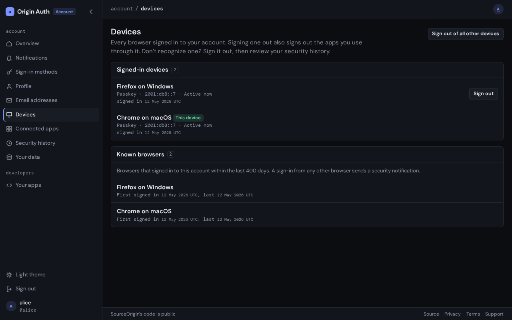

# Devices

The **Devices** tab of your settings, at `auth.sourceorigin.dev/settings/sessions`,
lists every browser signed in to your account. Use it to sign out a device you
lost, sold or no longer use.

## Before you start

You need to be [signed in](signing-in.md). Signing devices out needs no
passkey confirmation.

## Read the list

Each device shows:

- its browser and system, such as **Firefox on Windows**, marked **This
  device** for the browser you are using,
- how it signed in: **Passkey**, **Social sign-in**, or both,
- the network address of its last activity, and when that was, such as
  **Active 2 hours ago**,
- the day it signed in,
- if you are an administrator, a line for each admin dashboard signed in
  through it, such as **Admin dashboard · Active now**.

A device stays signed in for 30 days at most, then signs in again. The admin
dashboard signs out after 30 minutes without use, and 12 hours after you signed
in to it. Signing a device out signs its admin dashboard out too.

## Sign out a device

Select **Sign out** beside the device. The page says **The device was signed
out.**

Signing a device out also ends the access of the apps you signed in to through
it: they can't refresh it, and those that listen for it are told to sign you
out. An app's access token keeps working until it expires, within five minutes,
and an app that keeps its own session may keep you signed in until it next
checks with Origin Auth.

To sign out everywhere but here, select **Sign out of all other devices** at
the top of the page. The page says **Your other devices were signed out.**

To sign out the device you are using, select **Sign out** at the bottom of the
sidebar. See [signing in](signing-in.md#sign-out).

## Known browsers

Below the signed-in devices, **Known browsers** lists every browser that signed
in to your account within the last 400 days, signed in now or not, with when it
first and last signed in. A sign-in from any other browser sends you a
[security alert](security-alerts.md). Signing out keeps a browser known; a
private window, or clearing the browser's cookies, makes it new again.

## If you don't recognize a device

1. Sign it out.
2. Open your [security history](security-history.md) to see what it did, and
   report anything that wasn't you.

Removing a passkey or unlinking GitHub or Google also signs out every other
device, so a device that used it can't stay signed in. See
[sign-in methods](sign-in-methods.md).
