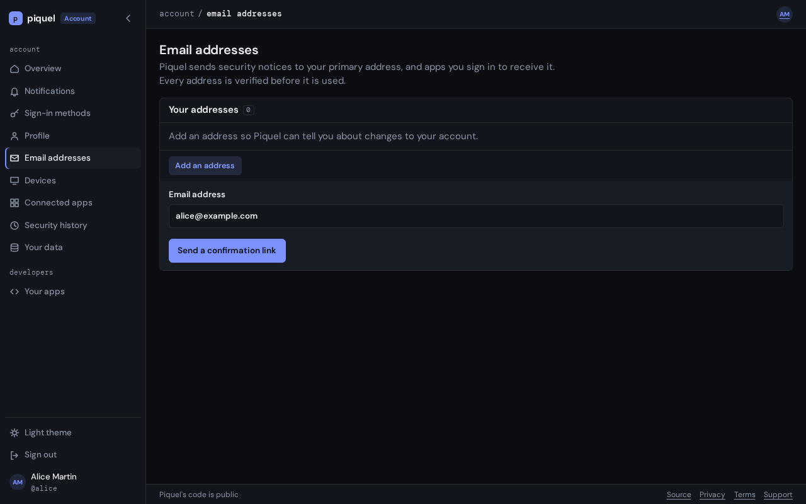

# Email addresses

The **Email addresses** tab of your settings, at
`auth.piquel.fr/settings/emails`, lists your addresses. Piquel sends security
notices to your primary address, and apps you allow to see your email address
receive it.

## Before you start

You need to be [signed in](signing-in.md). Adding an address, choosing your
primary one and removing one need a
[passkey confirmation](signing-in.md#passkey-confirmation).

## Add an address

1. Select **Add an address**.
2. Type the address under **Email address**.
3. Select **Send a confirmation link**, and confirm with your passkey if your
   browser asks.

The page says **We sent a confirmation link. Open it to confirm the
address.** The address shows **Waiting for confirmation** until you do.

An account can have up to 10 addresses.

## Confirm an address

1. Open the email from Piquel, titled **Confirm your email address for
   Piquel**, and open its link.
2. On **Confirm your email address**, select **Confirm this address**.

The page says **Address confirmed**. The link works once, for 24 hours, on any
device: you don't need to be signed in. If you are signed in to a different
Piquel account in that browser, the page refuses, so you never confirm an
address for someone else's account. The email names the account the address
joins: confirm only if it is yours.

Your first confirmed address becomes your primary address.

If the link expired, select **Resend link** beside the address.

## Choose your primary address

1. Select **Make primary** beside a confirmed address.
2. Confirm with your passkey if your browser asks.

The page says **Your primary address changed. We told your previous one.**
Piquel sends security notices to the new address from then on.

## Remove an address

1. Select **Remove** beside the address.
2. Select **Confirm removal**, and confirm with your passkey if your browser
   asks.

Piquel tells a confirmed address that it was removed. You can't remove your
primary address while another confirmed address could replace it: make that
one primary first.

## What apps receive

An app that asks for your email address, and that you allow, receives your
primary address, marked as confirmed. It never receives your other addresses,
or one you haven't confirmed. Apps see a new primary address the next time
they refresh your profile.

Without a confirmed address, apps receive none.

## Troubleshooting

- **"This address is already used by another Piquel account."** Another
  account confirmed it first. An address belongs to one account at a time.
- **"Too many verification emails were sent recently. Please try again
  later."** Piquel limits how many confirmation emails it sends in an hour.
  Wait, then select **Resend link**.
- **"This verification link is invalid, has expired or was already used."**
  Select **Resend link** beside the address for a new one.
- **"This link adds the address to a Piquel account other than the one you
  are signed in to."** Sign out first if the address is meant for the other
  account.
- **"Make another address your primary address before removing this one."**
  See [choose your primary address](#choose-your-primary-address).
