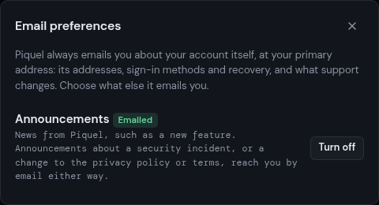

# Notifications

SourceOrigin tells you when something important happens to your account. Each
notice goes to your inbox, the **Notifications** tab of your settings at
`auth.sourceorigin.dev/settings/notifications`, and is emailed to you.

## Before you start

You need to be [signed in](signing-in.md) to read your inbox. To receive the
emails, you need a [confirmed email address](email-addresses.md).

## What SourceOrigin tells you

- Your primary email address changed, or an address was removed.
- SourceOrigin support changed your handle or display name, or removed your profile
  picture. When you change these yourself, SourceOrigin doesn't tell you: you
  already know.
- SourceOrigin support secured your account, or someone used a recovery link to add
  a passkey, or a recovery was undone.
- Your account was disabled, enabled again, scheduled for deletion or
  restored.
- SourceOrigin support sent you a message about your account, such as why it was
  disabled or what they need from you. You can't reply to it: the message says
  how to reach support.
- SourceOrigin sent an announcement, such as news of a security incident or a change
  to its privacy policy, to every account or to yours.
- If you administer Origin Auth, an alert about the service was raised, such as a
  broken audit chain. Its subject starts with **Alert:**.

## Read your inbox

The sidebar's **Notifications** tab shows how many are unread, and the
**Overview** says **You have an unread notification** while one is.

1. Open **Notifications**. The newest come first, with unread ones in bold.
2. Select one to open it. Opening it from SourceOrigin, a bookmark or the address
   bar marks it read. A link to it on another website, such as your webmail,
   doesn't.

A notification's page says what happened and shows its entry in your
[security history](security-history.md), with **This wasn’t me** if you can
report it. An alert concerns the service rather than your account, so it has
no entry, and **See the alerts** opens the admin dashboard's **Alerts** tab. A
message from support has no entry either: your inbox is where you read it.
Select **Mark as unread** to keep it in mind for later.

To mark every notification read, select **Mark all as read** in the inbox.
**Show older notifications** pages back through the rest.

## Emails

Each notification is also emailed, in one of two categories:

- **Security:** everything about your account itself, messages from support
  included. You always receive these, so nobody can hide one from you.
- **Announcements:** news from SourceOrigin, such as a new feature. You receive these
  by default, and can [turn them off](#turn-announcement-emails-off).

If you administer Origin Auth, you always receive alerts by email too, like
**Security** notifications.

Some announcements are **essential**: a security incident, or a change to the
privacy policy or terms. You receive those by email even with announcements
turned off. Either way, every announcement stays in your inbox.

The email says what the inbox says and links to the notification's page; an
announcement's or a message's email links your inbox.

- A change of primary address is emailed to the address that stopped being
  primary, and a removed address is told at that address.
- A recovery that adds a passkey, or support securing your account, is emailed
  to every confirmed address.
- Everything else goes to your primary address.

SourceOrigin's emails carry no tracking and no remote images.

## Turn announcement emails off

From your settings:

1. Open **Notifications**, then select **Email preferences** at the top of the
   page.
2. Select **Turn off** beside **Announcements**.

From an announcement's email, select **Stop receiving announcements by email**
at its end, then **Stop announcement emails** on the page it opens. Your mail
app may also offer an **Unsubscribe** button beside the sender, which does the
same in one click.

**Email preferences** then says **Not emailed** beside **Announcements**, and
your security history lists **Announcements: emails turned off**. Turn them
back on with **Turn on**, in the same place.

## Troubleshooting

- **No emails arrive.** Check that you have a confirmed primary
  [email address](email-addresses.md), and look in your spam folder. The
  inbox keeps every notice either way.
- **You still received an announcement.** It was essential, or its email had
  already left when you turned announcements off.
- **The unsubscribe page says "This link doesn’t work".** The link was cut off
  or changed. Open it from the email again, or turn announcements off in your
  settings.
- **A notification you don't recognize.** Open it, then follow its advice. If
  it wasn't you, report the entry with **This wasn’t me**, or write to
  [contact@sourceorigin.dev](mailto:contact@sourceorigin.dev).
