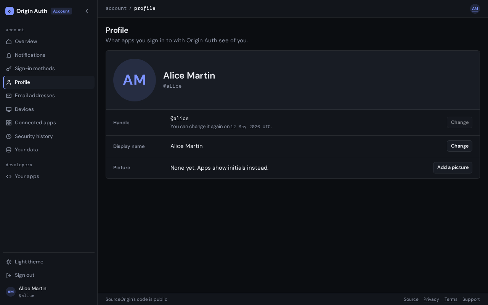

# Profile

The **Profile** tab of your settings, at `auth.sourceorigin.dev/settings/profile`,
holds what apps you sign in to with Origin Auth see of you: your handle, your
display name and your picture.

## Before you start

You need to be [signed in](signing-in.md). Changing your handle needs a
[passkey confirmation](signing-in.md#passkey-confirmation); the display name
and picture don't.

## Your handle

Your handle, such as `@alice`, is your account's public name. You sign in with
it, and apps that read your profile receive it as your username. It isn't
secret: anyone can check whether an account has a given handle, for example
on the sign-in page.

### Handle rules

A handle is 3 to 32 characters long: lowercase letters, numbers, and single
hyphens between them.

A handle can't be taken if another account has it or had it, or if it looks
too much like one that does, such as `rnary` beside `mary`. Names SourceOrigin uses
itself, such as `auth`, `www` or `sourceorigin`, are reserved. The page says which
handle blocks the one you chose.

### Change your handle

1. Select **Change** beside **Handle**.
2. Type the new handle in **Change your handle**.
3. Select **Change handle**, and confirm with your passkey if your browser
   asks.

Your old handle stops working right away: you sign in with the new one, and
links to the old one stop finding you. Apps see the new handle the next time
they refresh your profile. The old handle stays reserved for you, so nobody
else can take it, and you can take it back later.

If the handle you chose when you signed up isn't right, you can change it
straight away. After that, each change waits 30 days from the one before,
including a change support makes for you.
Until then, its **Change** button is disabled, and the page says when you can
change it again.

## Change your display name

Your display name is the name apps show for you. It can be up to 80
characters, and doesn't need to be unique.

1. Select **Change** beside **Display name**.
2. Type the new name under **Display name**, then select **Save name**.

Apps see it the next time they refresh your profile.

## Choose a profile picture

Apps show your picture beside your name, or your initials while you have none.

1. Select **Add a picture** beside **Picture**, or **Change** if you have one.
2. Under **Picture**, choose a PNG, JPEG or GIF of up to 10 MB.
3. Choose the square apps show: drag the picture, or use the arrow keys, to
   move it, and use **Zoom** to zoom in.
4. Select **Upload picture**.

Origin Auth keeps only the image, cropped to a square: nothing else in the file,
such as where a photo was taken. Apps show the new picture once they refresh
your profile.

To remove it, select **Remove** beside **Picture**, then **Remove picture**.
Apps show your initials instead.

## Troubleshooting

- **"Your handle changed less than 30 days ago."** Wait until the date the
  message gives.
- **"This handle looks too much like @…"** or **"This handle belonged to
  another account."** Choose another handle. See [handle rules](#handle-rules).
- **The picture is refused.** Use a PNG, JPEG or GIF of at most 10 MB.
- **"Another picture is being processed. Try again in a moment."** Origin Auth
  processes one picture at a time. Upload yours again a few seconds later.
