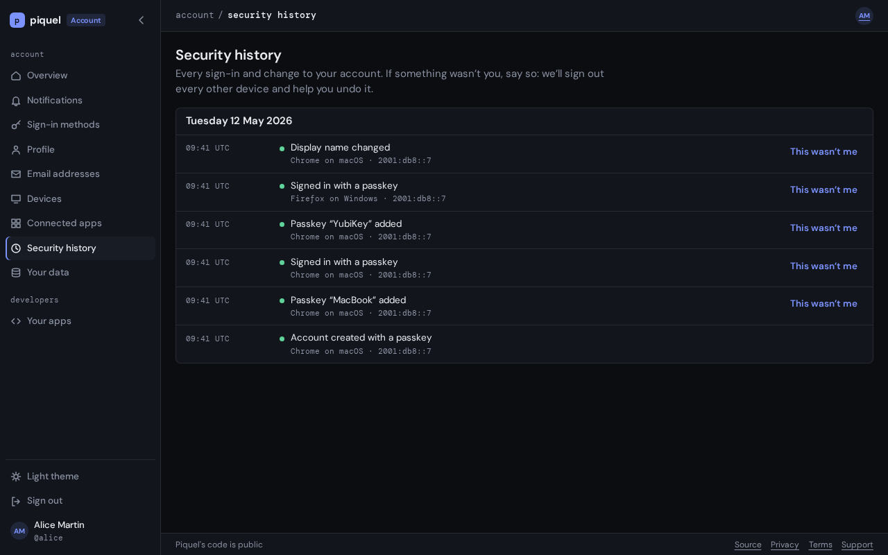

# Security history

The **Security history** tab of your settings, at
`auth.sourceorigin.dev/settings/history`, lists every sign-in and change to your
account. Read it to check that everything was you, and report anything that
wasn't.

## Before you start

You need to be [signed in](signing-in.md).

## Read your history

Entries are grouped by day, newest first, with times in UTC. Each says what
happened, such as **Signed in with a passkey** or **Passkey “YubiKey”
added**, then:

- the browser and system it came from, and its network address, unless
  SourceOrigin support made the change,
- the app it went through, as **App:** and the app's name,
- who did it, when it wasn't you: **By a SourceOrigin administrator** or **By a
  SourceOrigin operator**, with the reason they gave, **By an app**, or
  **Automatically by SourceOrigin**.

Entries that need a look, such as a report, a recovery or a change made by
SourceOrigin support, are marked with a warning dot.

The browser and network address are kept for 90 days. After that, the entry
says **Device details erased**.

**Show older activity** pages back through the rest. The **Overview** tab
shows the newest entries under **Recent security activity**.

## Report activity that wasn't you

Report an entry when you didn't do it: a sign-in you don't recognize, or a
change you didn't make.

1. Select **This wasn’t me** beside the entry.
2. Under **Secure your account?**, select **Sign out everywhere else**.

SourceOrigin then:

- signs out every device but the one you are using,
- ends the access of every app you use with Origin Auth, including on this device,
  so they ask you to sign in again once their access token expires, within five
  minutes, or when they next check with Origin Auth.

Your passkeys keep working. The page says **Your account is secured.**

If the entry added something, a passkey, a GitHub or Google sign-in, or an
email address, the page then offers to remove it, such as **Remove passkey
“YubiKey”**. Select it, and confirm with your passkey if your browser asks.

Only what was done while signed in to your account can be reported, and not
every entry of it, such as your own reports: the button shows where you can.
For a change SourceOrigin support made, write to
[contact@sourceorigin.dev](mailto:contact@sourceorigin.dev) instead.

A [notification](notifications.md)'s page also shows its entry, with **This
wasn’t me** where you can report it.

## If someone else has your account

Reporting signs out other devices, but a passkey they added keeps working
until you remove it. After reporting:

1. Remove any passkey you don't recognize on [sign-in methods](sign-in-methods.md),
   and unlink any GitHub or Google account that isn't yours.
2. Remove any email address that isn't yours on
   [email addresses](email-addresses.md).
3. Check [connected apps](connected-apps.md) for apps you didn't allow.

If you can't sign in any more, or need help, write to
[contact@sourceorigin.dev](mailto:contact@sourceorigin.dev). To report a vulnerability in
SourceOrigin, write to [security@sourceorigin.dev](mailto:security@sourceorigin.dev).
