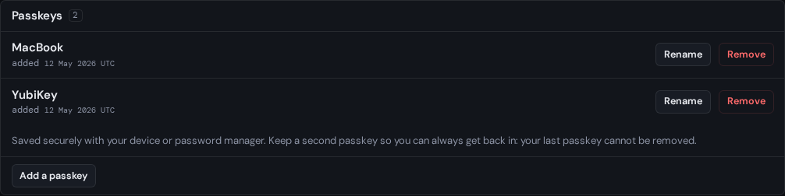

# Sign-in methods

The **Sign-in methods** tab of your settings, at
`auth.sourceorigin.dev/settings/sign-in`, lists the passkeys and the GitHub or Google
accounts that can sign in to your account. Use it to add a passkey for a new
device, tidy up old ones, and link or unlink GitHub and Google.

## Before you start

You need to be [signed in](signing-in.md). Adding, removing, linking and
unlinking need a [passkey confirmation](signing-in.md#passkey-confirmation):
your browser asks for your passkey first if you haven't used it in the last
five minutes.

## Add a passkey

Keep at least two passkeys, on different devices or password managers, so
losing one never locks you out.

1. Under **Passkeys**, select **Add a passkey**.
2. Under **New passkey name**, name it after where it is kept, such as
   `YubiKey`.
3. On Android, choose where to save it under **Save this passkey with**.
   **Google Password Manager on this device** saves it with Google Password
   Manager; choose it only if that is available on the device. Otherwise keep
   **Passkey or security key**.
4. Select **Create the passkey**, confirm with a passkey you already have if
   your browser asks, then create the new one.

The page says **The passkey was added.**

An account keeps at most 100 passkeys. With 100 already, SourceOrigin refuses another
before your device creates it, and says so: remove one you no longer use first.

## Rename a passkey

1. Select **Rename** beside the passkey.
2. Type its new name under **Passkey name**, then select **Save name**.

A name only helps you tell passkeys apart: it can be up to 80 characters.

## Remove a passkey

Removing a passkey can't be undone: it never signs in again. Removing one also
signs out every device but this one.

1. Select **Remove** beside the passkey.
2. Select **Confirm removal**, and confirm with a passkey if your browser asks.

Your last passkey can't be removed: its **Remove** button is disabled. Add
another passkey first. A linked GitHub or Google account doesn't count, since
only a passkey can authorize changes to your settings.

While a [recovery](../your-data/recover-your-account.md) of your account can
still be undone, only the recovery's own passkey can be removed: the others
keep their power to [undo it](../your-data/undo-a-recovery.md), and their card
says so.

Where the browser supports it, your password manager then forgets the removed
passkey, so it stops offering it. A security key keeps its copy, which no
longer works.

## Link GitHub or Google

Linking lets you sign in with a GitHub or Google account you already have.
It never replaces your passkeys. You can link one GitHub and one Google
account.

1. Under **Social sign-in**, select **Link GitHub** or **Link Google**.
2. Sign in at the provider and allow SourceOrigin.
3. Back on SourceOrigin, **Add this sign-in method?** asks you to confirm. Select
   **Verify passkey and add provider**, and confirm with your passkey if your
   browser asks.

You return to your sign-in methods, where the provider shows the email address
of the account you linked, if it shares one. If your account had no confirmed email address,
SourceOrigin also adds the provider's, as when you
[create an account with it](creating-an-account.md#create-an-account-with-github-or-google).

The **Overview** tab also offers **Link GitHub** or **Link Google** while one
is not linked. Select **Not now** to hide that suggestion in this browser.

## Unlink GitHub or Google

1. Select **Unlink** beside the provider.
2. Select **Confirm unlink**, and confirm with your passkey if your browser
   asks.

Your passkeys keep working. Unlinking signs out every device but this one, and
frees the GitHub or Google account, so it can be linked to another SourceOrigin
account.

## Troubleshooting

- **"Keep at least one passkey on your account."** You tried to remove your
  last passkey. Add another first.
- **"The passkey request was cancelled or unavailable."** You cancelled the
  browser's prompt, or the device can't create the passkey, as when it
  already holds one for your account, or a security key has no room to store
  it. Try again, or use another device.
- **"This provider account is already linked to another Origin Account."**
  Unlink it from that account first, or link another GitHub or Google account.
- **A provider says it is currently unavailable.** SourceOrigin no longer offers
  sign-in with it. You can still unlink it, but not sign in with it.
