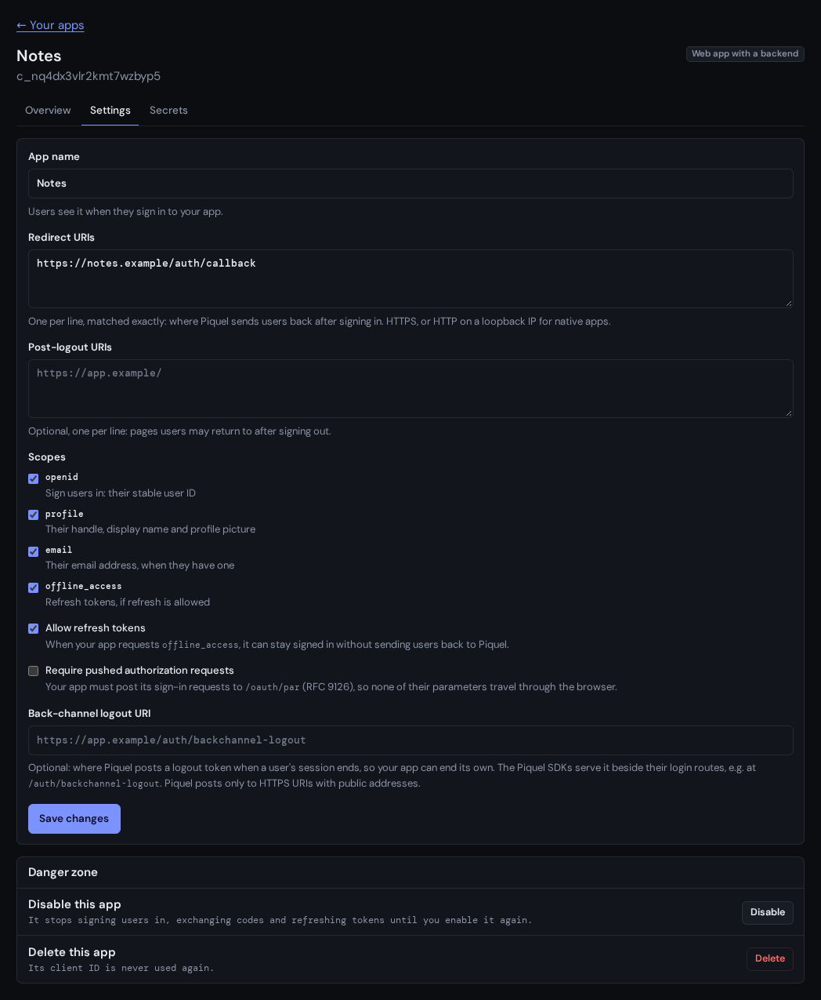

# Changing an app's settings

Change what your app may do, pause it, or delete it, from its **Settings** tab
in the developer console. Each change takes effect at once, for users already
signed in too.



## Before you start

- You need an app you [registered](register-an-app.md). Open it from **Your
  apps**, at `auth.sourceorigin.dev/developers`, then select its **Settings** tab.
- Every change needs a passkey confirmation from the last five minutes. If
  yours is older, your browser asks for your passkey before the change is
  sent.

## Change the settings

1. Change the settings in the form. [Settings](#settings) explains each one.
2. Select **Save changes**.

The page says **Your changes were saved.** A setting auth refuses is explained
beside its input, and nothing is saved.

What a change does to users already signed in:

- **Removing a redirect URI or a scope** stops the sign-ins under way that use
  it, and the codes not yet exchanged. A refresh token that holds a removed
  scope is refused at its next use, and stops working for good.
- **Turning off Allow refresh tokens** refuses every refresh token at its next
  use, for good, so users sign in again.
- **Turning on Require pushed authorization requests** stops the sign-ins under
  way that came through the browser.
- **Renaming the app** changes what the consent screen shows. Users who already
  consented aren't asked again.

## Disable an app

Disabling pauses an app: it can't sign users in, exchange codes or refresh
tokens until you enable it again.

1. Under **Danger zone**, select **Disable**.

The page says **The app was disabled.**, and the app shows **Disabled**.
Sign-ins under way and codes not yet exchanged stop. Access tokens the app
already holds keep working until they expire, within five minutes.

Disabling keeps your users' refresh tokens and consents. To pause an app because
its secret or a token leaked, [rotate the secret](rotate-secrets.md#after-a-leak)
too, or delete the app.

## Enable an app

1. Under **Danger zone**, select **Enable**.

The page says **The app was enabled.** Users' refresh tokens work again, and
users who consented aren't asked again.

## Delete an app

> **Warning:** deleting an app can't be undone, and its client ID is never
> used again, by you or anyone else.

1. Under **Danger zone**, select **Delete**.
2. Check the name in **Delete “\<name>”?**, then select **Delete for good**.

The console goes back to **Your apps** and says **The app was deleted.** The app
stops working at once: its refresh tokens are revoked, and its secrets and the
consents users gave it are removed. Its name and URIs are erased, so users'
security histories show it only as an app. Deleting it frees its place among
your 10 apps.

## Check that it works

Open the app's **Overview** tab. It shows the app's scopes, redirect URIs and
back-channel logout URI as auth now applies them, and says so when the app is
disabled or suspended. Then sign in to your app. A disabled app's sign-in stops
at auth, which answers instead of sending the browser back to your app:

```json
{"error":"invalid_request","error_description":"client_id is not a registered, enabled client"}
```

## Troubleshooting

- **The app shows Suspended.** An administrator suspended it, for example
  because it was abused. It can't sign users in, and you can't enable it until
  they lift the suspension, after which it is disabled until you enable it. You
  can still change its settings and delete it. Write to contact@sourceorigin.dev to
  restore it.
- **A redirect URI is refused with "must be written as …".** Write it as the
  message shows, which is how your app's library sends it: for example
  `https://app.example/`, not `https://APP.example`.
- **Users sign in again after a change.** Removing a scope or turning off
  refresh tokens ends the refresh tokens that relied on them.

## Settings

| Setting | What it does |
| --- | --- |
| **App name** | The name the consent screen shows: at most 80 characters, without SourceOrigin or another well-known brand, such as Google or GitHub, even disguised (`P1quel`). |
| **Redirect URIs** | 1 to 16 places, one per line, where Origin Auth sends users back after they sign in. Each is matched exactly, and must use HTTPS, or HTTP on a loopback IP such as `127.0.0.1` ([local development](local-development.md)). It can't contain a user name, a password or a fragment. |
| **Post-logout URIs** | Up to 16 pages, one per line, where users may return after signing out, under the same rules. None by default. |
| **Scopes** | What the app may ask for: `openid` (the user's stable ID), `profile` (their handle, display name and profile picture), `email` (their email address, when they have one) and `offline_access` (refresh tokens, if refresh is allowed). `openid`, `profile` and `email` by default. |
| **Allow refresh tokens** | Lets the app stay signed in without sending users back to Origin Auth, when it requests `offline_access`. Off by default. |
| **Require pushed authorization requests** | The app must post its sign-in requests to `/oauth/par` (RFC 9126), so none of their parameters travel through the browser. The SDKs push their requests whenever auth offers it. Off by default. |
| **Back-channel logout URI** | Where Origin Auth tells the app that a user's session ended ([back-channel logout](back-channel-logout.md)), under the same rules as redirect URIs. None by default. |

The kind of app, with a backend or without, can't change: register a new app
instead.
