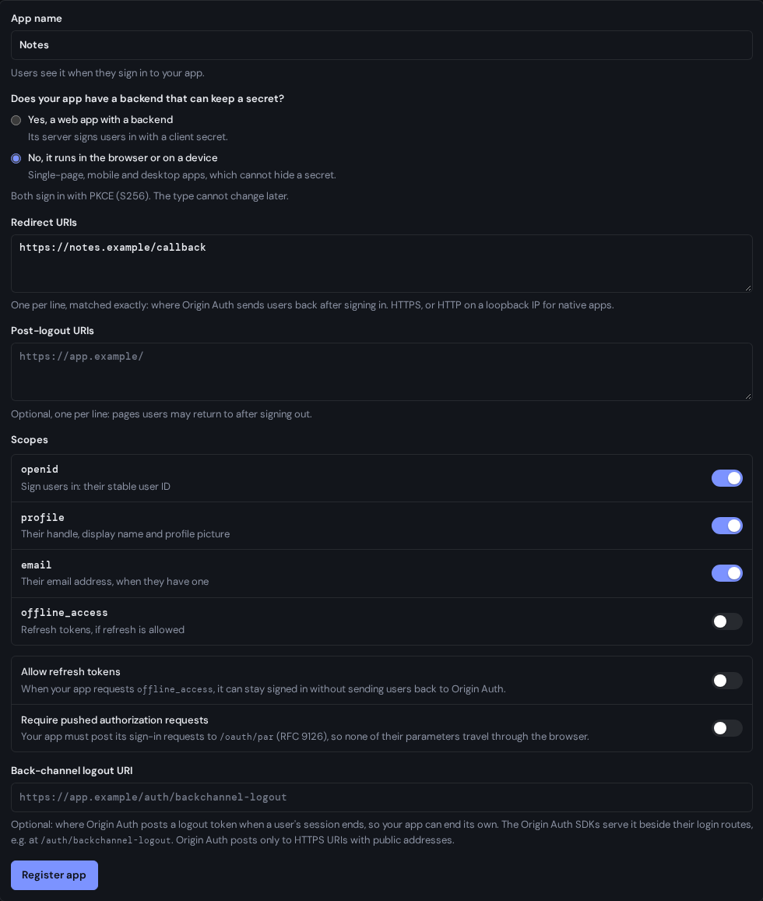
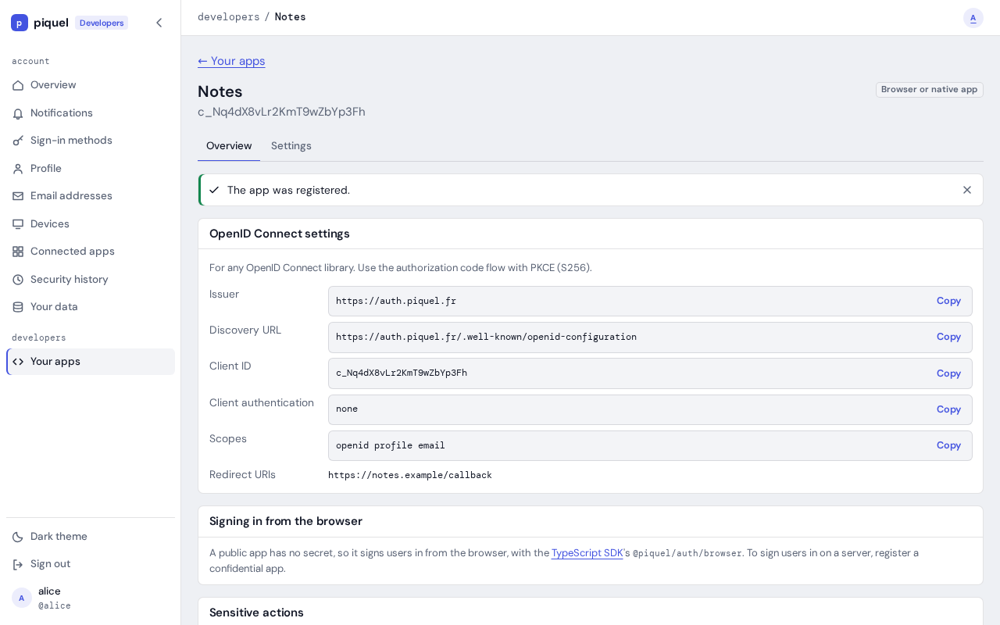

# Registering an app

Register your app in the developer console to get the client ID, and for an app
with a backend the client secret, it needs to sign users in with piquel.fr.

## Before you start

- You need a piquel.fr account with a passkey. Registering an app asks you to
  confirm with it.
- Know where your app receives users after they sign in: its redirect URI,
  such as `https://notes.example/auth/callback`. The SDKs' login routes serve
  it at `/auth/callback` when you mount them at `/auth`.
- Decide whether your app has a backend that can keep a secret. A server-rendered
  app does. A single-page, mobile or desktop app does not.

Piquel's own apps are registered by its operators, with `auth-service client`,
and never appear in the console: see [OIDC clients](../../dev/operations/clients.md).

## Register an app

1. Open the developer console, at `auth.piquel.fr/developers`, and select
   **New app**.
2. Fill in **App name**. Users see it on the consent screen when they sign in
   to your app.
3. Answer **Does your app have a backend that can keep a secret?**:
   - **Yes, a web app with a backend**: your server signs users in with a
     client secret.
   - **No, it runs in the browser or on a device**: your app signs users in
     without a secret.

   You can't change this later. Both kinds sign in with PKCE.
4. Fill in **Redirect URIs**, one per line.
5. If your server signs users in with the SDKs' login routes, check
   `offline_access` under **Scopes**, and **Allow refresh tokens**. The routes
   request `offline_access` at every sign-in, and use refresh tokens to learn
   when a user's session at Piquel ends. Leave the other settings as they are
   for now: [app settings](app-settings.md) explains each one.
6. Select **Register app**. If you haven't used your passkey in the last five
   minutes, your browser asks for it first.

An app with a backend then shows **Your client secret**. This is the only time
Piquel shows it: copy it into your app's secret store or environment, then
select **I saved it**. Piquel keeps only a digest of it, so a lost secret can't
be shown again; [rotate it](rotate-secrets.md) instead.

## Connect your app

The app's **Overview** tab shows what an OpenID Connect library needs: the
**Issuer**, the **Discovery URL**, the **Client ID**, the **Client
authentication** method and the **Scopes**. An app with a backend also gets a
Rust example that signs users in with the
[Rust SDK](https://github.com/piquel-fr/piquel-fr/tree/main/crates/auth-sdk).
A browser app signs users in with the
[TypeScript SDK](browser-apps.md).

Auth chooses the client ID: `c_` followed by 20 random characters.

## Check that it works

Sign in to your app. Piquel shows the consent screen, which names your app, the
host your redirect URI sends users back to, and says the app is unverified and
registered by your handle. Apps registered in the console always ask for
consent.

Back in the console, **Your apps** lists the app with when it was last used, to
within an hour.

## Troubleshooting

- **A setting is refused.** The form says what to fix beside its input. Common
  refusals are a redirect URI that isn't HTTPS, and a name containing Piquel or
  another well-known brand, such as Google or GitHub, even disguised
  (`P1quel`). [App settings](app-settings.md#settings) lists every rule.
- **Signing in to your app fails with `invalid_scope`, "scope includes values
  this client may not request".** The app asks for a scope its registration
  doesn't allow, often `offline_access`, which the SDKs' login routes always
  request. Check it under **Scopes** on the app's **Settings** tab.
- **There's no New app button.** An account can have 10 apps at once. Delete
  one to register another.
- **Registering is refused for today.** An account can register 20 apps a day,
  deleted ones included.
- **An app's page answers `404`.** The app was deleted, or another account
  registered it.

[Troubleshooting](troubleshooting.md) covers errors your app sees while users
sign in.
