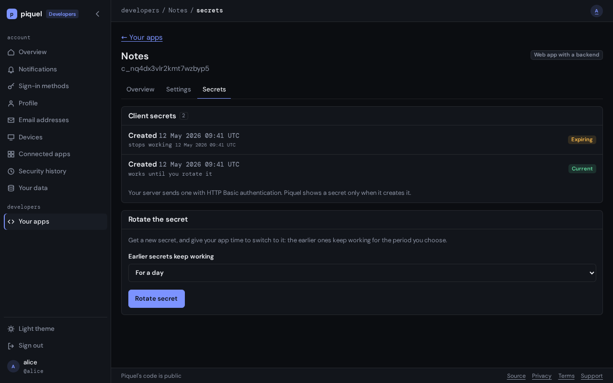

# Rotating a client secret

Give your app a new client secret, and switch it over without signing anyone
out. Rotate when someone who knew the secret leaves, on a schedule, or at once
after a leak.

## Before you start

- You need an app with a backend: only those have a secret, and a **Secrets**
  tab. Open the app from **Your apps**, at `auth.piquel.fr/developers`.
- Have a way to update the secret where your app runs, such as its secret
  store or environment, and to redeploy it.
- Rotating needs a passkey confirmation from the last five minutes. If yours is
  older, your browser asks for your passkey first.

Piquel's own apps are rotated by its operators, on the admin dashboard or with
`auth-service client rotate-secret`: see
[OIDC clients](../../dev/operations/clients.md).

## Rotate a secret

1. Open the app's **Secrets** tab. **Client secrets** lists when each secret
   was made and when it stops working, never its value.
2. Under **Rotate the secret**, choose how long **Earlier secrets keep
   working**: **For an hour**, **For a day**, **For a week** or **For 30 days**.
   Choose more time than your app takes to deploy. **For a day** is the
   default.
3. Select **Rotate secret**.
4. Piquel shows **Your client secret**, only this once. Copy it into your app's
   secret store or environment, then select **I saved it**.

Every earlier secret now stops working at the end of the period you chose, or
earlier if an earlier rotation said so. The new secret works until you rotate
again.

## Switch the app over

1. Give your app the new secret, and deploy it. Each SDK takes it as the
   client's secret: `Credentials::Secret` in Rust, `clientSecret` in
   TypeScript.
2. Check that the app signs users in, as [below](#check-that-it-works).

Users stay signed in throughout: their refresh tokens work with whichever secret
the app sends.

## After a leak

If the secret leaked, stop the earlier secrets at once, even though your app
can't sign users in until it has the new one:

1. On the **Secrets** tab, choose **Stop them now** under **Earlier secrets
   keep working**, then select **Rotate secret**.
2. Save the new secret, and deploy your app with it.

A refresh token is useless without the app's secret, so this also stops anyone
who copied your users' refresh tokens. Do the same if the key that seals your
app's session cookies leaked: changing that key alone signs users out, but
doesn't end the refresh tokens in cookies already copied.

To stop the app entirely while you investigate, [disable it](app-settings.md#disable-an-app).

## Check that it works

1. Sign in to your app. The sign-in completes, so the app's new secret works.
2. On the **Secrets** tab, the new secret shows **Current**, and earlier ones
   **Expiring** until their period ends, then **Expired**.

## Troubleshooting

- **The app's code exchanges fail with `invalid_client`, "the client secret is
  incorrect or expired".** The app still sends an earlier secret whose period
  ended, or sends it wrong. Deploy the current secret. Your app sends it with
  HTTP Basic authentication, which the SDKs do for you.
- **You lost the secret before saving it.** Piquel can't show it again. Rotate
  once more, and save the new one.
- **The Secrets tab is missing.** The app runs in the browser or on a device, so
  it has no secret. An app's kind can't change: register an app with a backend
  instead.
