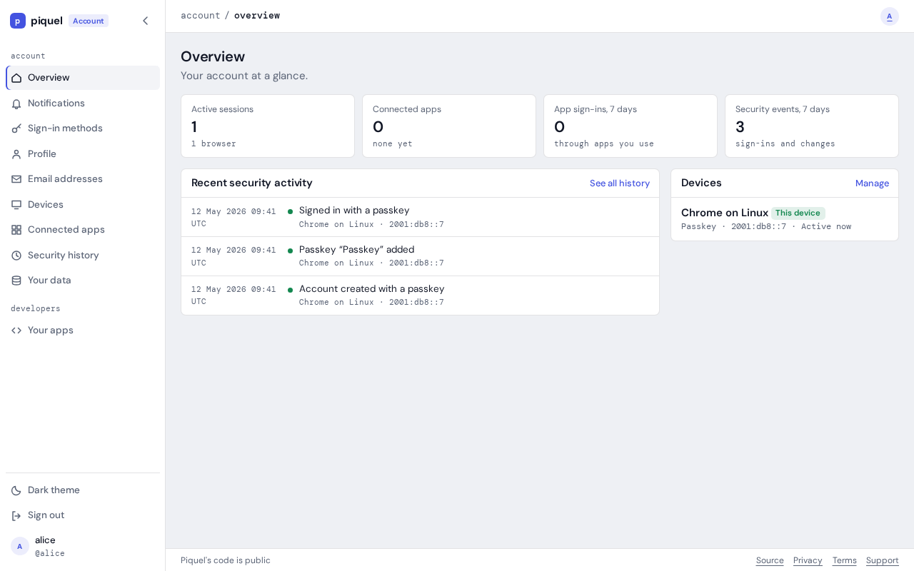
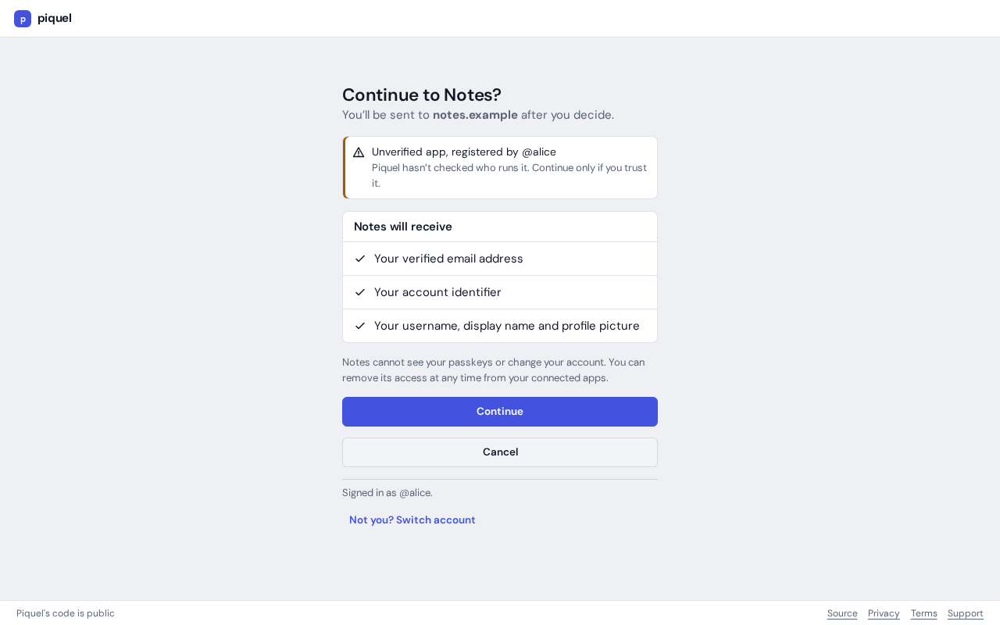

# Introduction

An Origin Account signs you in with a passkey: a key your device or password
manager keeps, which your fingerprint, face or PIN unlocks. There is no
password to remember or leak. You can also link a GitHub or Google account to
sign in with.

Your account lives at [auth.sourceorigin.dev](https://auth.sourceorigin.dev). Its settings,
at `auth.sourceorigin.dev/settings`, manage your passkeys, email addresses, devices,
the apps you signed in to, your notifications and your data.

## Find a setting

The search box at the top of every settings and developer console page finds
any setting as you type. Press **/** or **Ctrl+K** (**⌘K** on a Mac) to jump
to it from anywhere on the page.

1. Type a few letters of what you are looking for, such as `passk` or
   `delete`. Words other sites use work too, such as `password`, `username` or
   `export`, and so does a small typo.
2. The results list pages, settings on them, such as **Change display name**,
   and your own apps in the developer console, with their **Settings** and
   **Secrets**. The best match is highlighted.
3. Press **Enter** to open the highlighted result, or use the arrow keys to
   choose another. A setting opens on its page, with its dialog open if it has
   one. **Escape** closes the list.

## Words this guide uses

- **Handle:** your account's public name, such as `alice`. You sign in with it,
  and apps receive it. See [your handle](account/profile.md#your-handle).
- **Passkey:** a credential bound to your account. An account can have several,
  one per device or password manager.
- **Session:** one device signed in to your account. Settings list your
  [devices](account/devices.md), and you can sign any of them out.
- **App:** a website or service that signs you in with your Origin Account.
  The first time, it asks for your consent, naming what it will receive. Apps
  SourceOrigin runs itself don't ask.

  
- **Passkey confirmation:** sensitive changes, such as removing a passkey, need
  you to have used your passkey in the last five minutes. If you haven't, Origin Auth
  asks for it again first, even though you are signed in. See
  [passkey confirmation](account/signing-in.md#passkey-confirmation).

## Your account

- [Creating an account](account/creating-an-account.md) with a passkey, or
  starting from GitHub or Google.
- [Signing in](account/signing-in.md) and signing out.
- [Sign-in methods](account/sign-in-methods.md): adding and removing passkeys,
  and linking GitHub or Google.
- [Profile](account/profile.md): your handle, display name and picture.
- [Email addresses](account/email-addresses.md): adding and confirming
  addresses, and choosing the one apps receive.
- [Devices](account/devices.md): the browsers signed in to your account.
- [Connected apps](account/connected-apps.md): the apps that can use your
  account.
- [Notifications](account/notifications.md): what SourceOrigin tells you, in your
  inbox and by email.
- [Security history](account/security-history.md): every sign-in and change,
  and reporting what wasn't you.

## Your data

- [Recover your account](your-data/recover-your-account.md) if you lost every
  passkey.
- [Undo a recovery](your-data/undo-a-recovery.md) that wasn't you.
- [Download your data](your-data/export-your-data.md): everything SourceOrigin keeps
  about you, in one file.
- [Delete your account](your-data/delete-your-account.md), and restore it
  within 30 days.

## Building an app

Any account can register apps in the developer console, at
`auth.sourceorigin.dev/developers`. An app then signs its users in through OpenID
Connect, with the Rust SDK (`sourceorigin-auth`), the TypeScript SDK
(`@sourceorigin/auth`), or any OpenID Connect library:

- [How sign-in works](apps/how-sign-in-works.md) explains the concepts, and
  which SDK to pick.
- [Registering an app](apps/register-an-app.md) covers the console, then
  [changing an app's settings](apps/app-settings.md) and
  [rotating its secret](apps/rotate-secrets.md).
- [Signing in with Rust](apps/sign-in-rust.md),
  [signing in with TypeScript](apps/sign-in-typescript.md) and
  [browser apps](apps/browser-apps.md) sign users in with the SDKs.
- [Protecting an API](apps/protect-an-api.md) validates access tokens.
- [Developing on your machine](apps/local-development.md) and
  [deploying with piqueld](apps/deploying-with-piqueld.md) cover where your
  app runs.
- [Step-up authentication](apps/step-up.md) asks for a fresh passkey before a
  sensitive action.
- [Back-channel logout](apps/back-channel-logout.md) ends an app's session when
  the user's session at auth ends.
- [Troubleshooting sign-in](apps/troubleshooting.md) explains the errors your
  app may see.
- [OpenID Connect](reference/oidc.md) lists the endpoints, tokens and claims.

Building with an AI coding agent? [Building with coding agents](agents/overview.md)
explains what it can do for you, with skills to give it.
