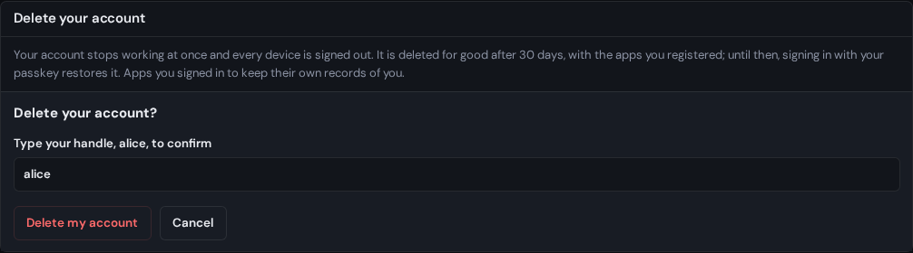

# Delete your account

You can delete your piquel.fr account from your settings. It stops working at
once, and is deleted for good 30 days later. Until then, you can restore it.

## Before you start

- You need one of your account's passkeys: deleting needs a
  [passkey confirmation](../introduction.md#words-this-guide-uses).
- [Download your data](export-your-data.md) first if you want to keep a copy.
  Once the account is deleted for good, nobody can get it back.
- The apps you registered in the developer console are deleted with your
  account.

## Delete it

Deleting signs every device out at once, and after 30 days it can't be undone.

1. In your settings, open **Your data**.
2. Under **Delete your account**, select **Delete account**.
3. Type your handle in **Type your handle, \<handle>, to confirm**.
4. Select **Delete my account**.
5. If Piquel asks, confirm with your passkey.

The page says "Your account is scheduled for deletion", with the date it will
be deleted for good.

## What happens right away

- Every device is signed out. Signing in with a passkey only offers to
  [restore the account](#restore-your-account).
- Apps can no longer use your account, or sign you in with it.
- A recovery link support sent you stops working.
- Your primary email address receives "Your account is scheduled for
  deletion", with the date.

## Restore your account

For 30 days, signing in with one of your account's passkeys offers to restore
it instead.

1. Open the sign-in page, at `auth.piquel.fr/login`, or select **Restore my
   account** on the page that confirmed the deletion.
2. Sign in with your passkey. The page asks "Restore your account?" and says
   when the account will be deleted.
3. Select **Restore my account**.

Your account works again, and you are signed in. Your primary email address
receives "Your account was restored". **Keep it scheduled** leaves the account
to be deleted.

## What is deleted at the end

After 30 days, Piquel deletes:

- your account, with its profile, profile picture, email addresses, passkeys
  and linked GitHub or Google accounts,
- your devices, and every app's access,
- the apps you registered,
- the personal details recorded with your security history, such as IP
  addresses and devices.

Some things stay:

- **Your security events,** without any personal details. What is left of them
  no longer names you: only IDs that point to no account.
- **Your handles.** Nobody else can take a handle your account held, unless
  Piquel support releases it.
- **What apps keep.** Apps you signed in to keep their own records of you. Ask
  each app to delete them.

## Deletion by Piquel support

Piquel support can also schedule your account's deletion, or restore it, for
example when you ask them at [contact@piquel.fr](mailto:contact@piquel.fr). You
receive the same emails, and your **Security history** shows the reason support
gave.

Support can also delete an account at once, skipping the 30 days. That can't
be undone.

## Troubleshooting

- **"Type your handle exactly as shown to confirm."** The handle you typed isn't
  the account's. Type it as the form shows it.
- **"This restore offer has expired."** The offer lasts five minutes after you
  sign in. Sign in with your passkey again.
- **"A passkey added by a recovery can't restore it."** A passkey added by a
  [recovery](recover-your-account.md#the-first-15-days) can't restore the
  account during its first 15 days. Use a passkey you had before, or ask
  support.
- **You lost your passkey.** Ask support to restore your account.
