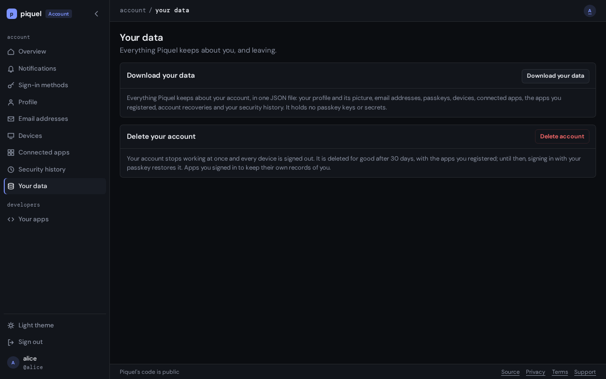

# Download your data

You can download everything SourceOrigin keeps about your account, in one JSON file,
from your settings.

## Before you start

You need one of your account's passkeys: downloading needs a
[passkey confirmation](../account/signing-in.md#passkey-confirmation). A passkey
added by a [recovery](recover-your-account.md#the-first-15-days) can't download
your data during its first 15 days.

## Download it

1. In your settings, open **Your data**.
2. Select **Download your data**.
3. If Origin Auth asks, confirm with your passkey.

Your browser saves a file named `sourceorigin-account-<handle>-<date>.json`. The
download is recorded in your **Security history**, as "Account data
downloaded".

## What the file holds

- your profile: account ID, handle, display name, and when the account was
  created,
- your profile picture,
- every handle the account holds or held, with their dates,
- your email addresses, confirmed or not,
- your passkeys: their names, when they were added, last used and removed, and
  whether they sync between devices,
- the GitHub or Google accounts linked to it, and when each was linked and
  unlinked,
- the devices signed in to your account, with their IP addresses and the apps
  each signed in to,
- the apps you gave access to, with what each may read, and their access
  grants,
- the apps you registered in the developer console, deleted ones included,
- the recoveries support started for your account,
- your notifications, with which kinds you receive by email, and the
  announcements you received,
- every event recorded about your account, as stored: what your security
  history shows, and also failed sign-ins, passkey confirmations and sign-ins
  to apps, with the IP address and browser while they are kept,
- whether you are an administrator, and your sign-ins to the admin dashboard.

What you removed, such as a passkey or a signed-out device, is in the file
until it is deleted: see [how long it is kept](#how-long-it-is-kept).

## What it doesn't hold

- **Secrets.** It holds no passkey keys, no tokens and no recovery links.
- **When an administrator looked at your account.** Your security history
  doesn't show it either.
- **What apps keep.** Apps you signed in to keep their own records of you. Ask
  each app for its data.

Only you can download your data. SourceOrigin support can't download it for you.

## How long it is kept

Most of your data stays until you delete your account. What you no longer use
is deleted on its own:

- passkeys you removed, GitHub or Google accounts you unlinked, and account
  recoveries, 90 days after they end,
- signed-out devices, within a day or two, or a month at most,
- the IP address and browser of each security history entry, after 90 days,
- your notifications, and the record that you received an announcement, after
  a year.

## Troubleshooting

- **"Other downloads are being prepared. Try again in a minute."** SourceOrigin
  prepares only a few downloads at once. Wait a minute, then select **Download
  your data** again.
- **The download fails partway.** The file is never saved incomplete. Select
  **Download your data** again.
